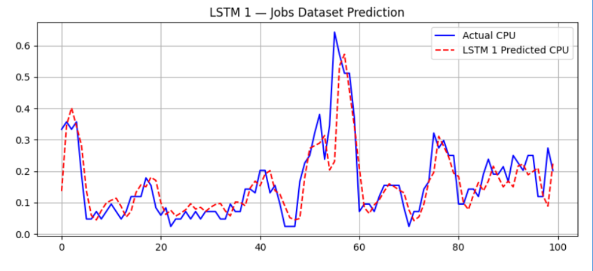
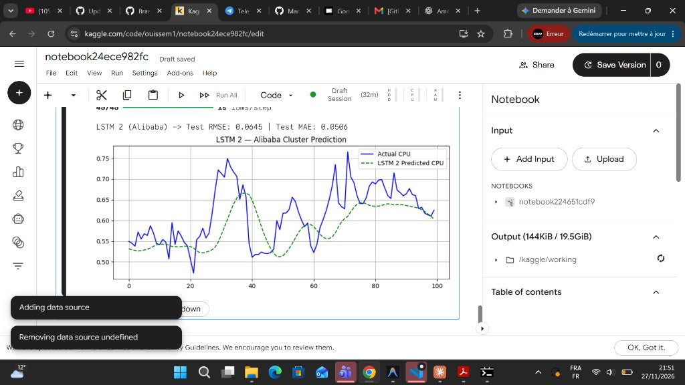

# Datacenter Workload Forecasting with 2 Separate LSTMs

Predicting server CPU workload using Deep Learning to enable proactive energy-efficient cooling in datacenters.

## Files
1. **`lstm_job.py` (LSTM 1):** Trained on *Cloud Workload Job Traces* (`zoya77` / `cloud_workload_dataset.csv`).
2. **`lstm_2.py` (LSTM 2):** Trained on *Alibaba Cluster Trace GPU v2020* (`derrickmwiti/cluster-trace-gpu-v2020` / `pai_machine_metric.csv`).

## Results

### LSTM 1 — Jobs Dataset (`lstm_job.py`)
* **Test RMSE:** `0.0811`
* **Test MAE:** `0.0534`
* **Validation Loss:** `0.0066` (`val_mae: 0.0534`)



### LSTM 2 — Alibaba Cluster Trace (`lstm_2.py`)
* **Test RMSE:** `0.0645`
* **Test MAE:** `0.0506`
* **Best Validation Loss:** `0.0018` (`val_mae: 0.0455`)



## Run on Kaggle
```bash
python lstm_job.py
python lstm_2.py
```
